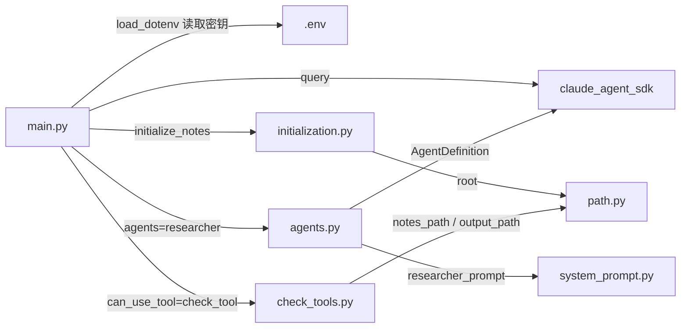

# 05 Research Agent · 项目树

> 更新日期：2026-10-18
> 只画**真实存在**的东西；文件或目录第一次真正创建时才加进来。

---

## 一、知识点树

状态：⬜ 未开始 · 🟨 进行中 · ✅ 已完成

```
05 Research Agent
├── 阶段 1 · 地基：一个 agent 是怎么跑起来的
│   ├── ✅ 1  SDK 怎么驱动 agent 循环              核心·可推理型
│   ├── ✅ 2  一个 agent 使用工具（ReAct 循环）     核心·可推理型   依赖 1
│   └── ✅ 3  工具的"看得见"和"被批准"              核心·可推理型   依赖 2
│       → 阶段 1 测验 ✅ + 迁移任务 ✅（2026-10-15）
├── 阶段 2 · 委派边界（项目核心）
│   ├── ✅ 4  最小两层 + 上下文隔离                 核心·可推理型   依赖 3
│   ├── ⬜ 5  派单契约                              核心·可推理型   依赖 4
│   └── ⬜ 6  用文件交接                            核心·可推理型   依赖 4
│       → 阶段 2 测验 + 迁移任务
├── 阶段 3 · 汇总与并行（第一版达标）
│   ├── ⬜ 7  写报告的子 agent                      核心·可推理型   依赖 6
│   └── ⬜ 8  并行 2 个研究员 + 等齐结果             核心·可推理型   依赖 4、7
│       → 阶段 3 测验 + 迁移任务
├── 阶段 4 · 可观测与护栏
│   ├── ⬜ 9  记录谁干了什么（hook + JSONL）         核心·可推理型   依赖 8
│   ├── ⬜ 10 按角色强制分工                         核心·可推理型   依赖 3、9
│   └── ⬜ 11 三个上限                              核心·规定型     依赖 4
│       → 阶段 4 测验 + 迁移任务
├── 阶段 5 · 带着上下文追问（待定）
│   └── ⬜ 12 query() + resume vs ClaudeSDKClient   核心·可推理型   依赖 8
└── 收尾 · 与 demo 整体对比
```

---

## 二、项目结构

```
05_ResearchAgent/
├── .env                 # API 密钥（不进 git）
├── .gitignore           # 忽略 example_program/、.env、issue.md、__pycache__/、test.md、fake_secret.txt、output/、notes/、personal_notes/
├── .vscode/
│   └── settings.json    # VS Code 使用 conda 环境
├── main.py              # 只放 SDK 主流程：load_dotenv、ClaudeAgentOptions（tools=["Read","Write","Agent"]、agents={"researcher": researcher}、can_use_tool=check_tool、permission_mode="default"、max_budget_usd）、query() 循环（init / 文字 / 调用单含 id / 结果单含 tool_use_id / UserMessage 字符串 / 结束账单；每条 Assistant / User 消息先打印 [main] 或 [sub]: parent_tool_use_id）
├── check_tools.py       # 检查函数：check_tool（入口，按 tool_name 分支）、check_Write（只准写 output/ 下的 .md）、check_Read（只准读 notes/，项目内读文件实际不经过它）；用 path 里的两个路径
├── initialization.py    # 启动时自动创建 notes/ 文件夹：initialize_notes()（mkdir，已存在就跳过）；在 main() 第一行调用，目前直接用 root / "notes"（计划改成 notes_path）；截至 2026-10-17 从未运行过
├── agents.py            # 子 agent 定义：researcher = AgentDefinition(description、prompt=researcher_prompt、tools=["Read","Write"]、model="haiku")；由 main.py 引用（2026-10-18 建）
├── system_prompt.py     # 所有 agent 的系统 prompt 统一放这里（字符串常量）；目前只有 researcher_prompt；由 agents.py 引用（2026-10-18 建）
├── path.py              # 路径只在这里算：root = 本文件所在文件夹（__file__ → resolve → parent），notes_path / output_path 从 root 接出；直接运行会打印三个路径（自测用）
├── notes/               # 测试用笔记（a.txt）
├── personal_notes/      # 用户自己的学习笔记（subagent.md；不进 git）
├── output/              # 允许 agent 写入的文件夹
├── README.md            # 占位，已清空
├── issue.md             # skill / 教学问题记录（不进 git）
├── _learning/           # 学习文档（本文件所在）
│   ├── learning_log.md
│   ├── project_tree.md
│   └── review.md
└── example_program/     # 官方 demo，只读参考（不进 git）
```

### 文件之间的调用关系



依赖方向是单向的：`main → check_tools → path`、`main → initialization → path`、`main → agents → system_prompt`，没有绕圈。

远端仓库：`https://github.com/Andiey-126/ResearchAgent`（公开，`origin`，`main` 分支）。
